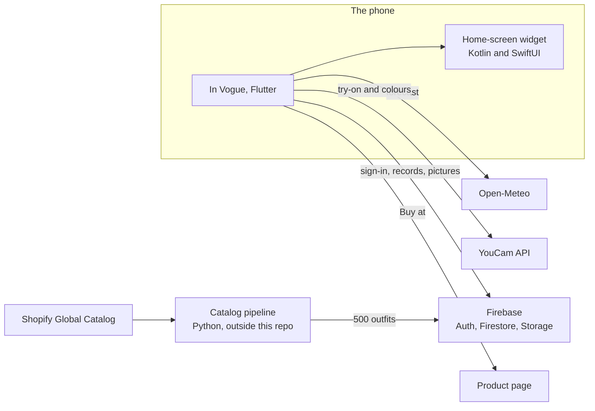

# In Vogue

In Vogue is a weather app for women, on Android and iPhone, that shows you in tomorrow's outfit. For now it's for women aged 16 and older. You add a full-body photo once. Each day the app picks an outfit from a real women's collection for the forecast where you are and for your plans, then dresses your photo in it with YouCam's AI Clothes Virtual Try-On. An optional selfie goes through YouCam's AI Facial Color Tones Analyzer, so the outfits it picks are in colours that suit you. Every piece links to the shop.

I built it on my own for the [YouCam API Skin AI & eCommerce VTO Hackathon](https://youcam-api-skin-ai-ecommerce.devpost.com), starting on October 15, 2026. The catalog is Everlane's women's collection: 623 styles in 1,234 colourways, put together into 500 outfits. Rights to the catalog and brand content are in place.

## Try it

<!-- Add the links here: the Android APK (GitHub release) and the TestFlight public link. -->

The install links and the demo video are on the Devpost page. Both builds are the development flavor (`com.invogue.app.dev`, called "In Vogue Dev" on the phone) and use the `in-vogue-dev` Firebase project.

- Android 7.0 or newer. Sign in with Google.
- iPhone with iOS 15 or newer (the widget needs iOS 17). Sign in with Apple or Google.

Any account works. Every outfit is women's clothing, so test it with photos of a woman: your own, or ones you have permission to use. Allow location, choose a full-body photo (standing, head to toe, facing forward) and sign in. Home then makes today's and tomorrow's outfits, one garment at a time. Add a selfie on the Mirror tab for the colour reading.

## Contents

- [What it does](#what-it-does)
- [How YouCam is used](#how-youcam-is-used)
- [How it works](#how-it-works)
- [Data](#data)
- [Build it yourself](#build-it-yourself)
- [Commands](#commands)
- [Tests](#tests)
- [Security and privacy](#security-and-privacy)
- [Roadmap](#roadmap)

## What it does

### Setup

Six screens, and the app reopens on the one you left:

1. Welcome, with "Use my location" (approximate location only) and a language choice.
2. Your photo: a full-body photo from Photos or Gallery. There's no camera.
3. Tomorrow's weather, with 40 sample outfits below it to heart. They're the same for everyone, because the hearts record taste, not the weather.
4. Sign in with Apple (iPhone only) or Google. Nothing leaves the phone before this, and YouCam is never called before it.
5. About you: your name and an optional selfie for the colour reading.
6. Add the widget. Android's launcher places it; iPhone shows the three steps.

### Home

Today, Tomorrow and Outfits, switched by tapping or swiping. Each day shows the weather that matters for its occasion (temperature, feels-like range, when rain starts, strong wind), the occasion with "Change occasion", and you in the day's outfit, revealed with a curtain once it's made. While it's being made, the screen says "Getting your outfit ready…" with "Piece 2 of 3" and so on. Under the outfit come Shop and "About this outfit", and, when one of your own outfits suits the day, that outfit too.

Home opens on today from 6:00 to 8:59 and on tomorrow the rest of the day, unless you set Settings > Default day to Today. The occasion defaults to Work on weekdays and Casual at the weekend, and a changed occasion stays with its date.

The Outfits view pages through all 500 outfits, with hearts. The weather chips (Hot, Warm, Mild, Cool, Cold, Freezing, Rain) narrow it to one weather; tapping the chosen chip again shows everything.

### Shop and Your picks

Shop lists each piece of an outfit with its photo, colour, name and material, and a "Buy at Everlane" link that opens that exact item. There are no prices. Your picks shows the outfits you hearted; removing one asks first.

### Mirror

Your colour season, why (undertone, depth and contrast), and its palette in round swatches: 12 colours that suit you, 6 neutrals and 4 to go easy on. Tapping a swatch gives its name (the nearest of 79 clothing colours) and how to wear it. "See your full analysis" shows the colours read from your photo (skin, hair, brows, eyes, lips) and what they mean for you. YouCam reads the colours once per person; the season is In Vogue's own suggestion from them, and the screen says so.

Below the palette is My wardrobe: photos of outfits you own, each with a name, one or more colours, the weather it suits and its occasions. Home suggests one of them for today and one for tomorrow.

### Settings

Your profile and both photos (replacing the selfie offers to redo the skin analysis; otherwise your colours stay), membership, location, default day, language, the widget, Log out and Delete account.

### The widget

Small (weather only), Medium and Large, on Android and iPhone. It shows the day's weather beside you in the day's outfit, picks the day the way Home does, and switches at 6:00, 9:00 and midnight. Until the outfit is ready it shows your photo faded under "Getting ready". A tap opens Home on that day. A background job refreshes the weather each morning from 5:30, and it never calls YouCam.

### Languages

English by default, whatever the phone's language, plus Spanish and Simplified Chinese, including each outfit's reason.

## How YouCam is used

Two YouCam APIs, called only after sign-in, through one client in `lib/core/data/you_cam/` (base URL `https://yce-api-01.makeupar.com`, API v2.0):

| API | Task path | What In Vogue uses it for | Units |
| --- | --- | --- | --- |
| AI Clothes Virtual Try-On V4 | `cloth-v4` | Dressing the body photo, one garment per task | 2 per pass |
| AI Facial Color Tones Analyzer | `skin-tone-analysis` | Skin, hair, brow, eye and lip colours from the selfie | 20, once per person |

YouCam charges nothing for a failed task.

### Trying on an outfit

`MakeOutfit` (`lib/features/outfits/domain/services/make_outfit.dart`) and `TryOnRepositoryImpl` do the work:

1. Upload the body photo through the File API: `POST /s2s/v2.0/file` returns a file id and an upload URL, and the bytes go to that URL without the API key.
2. Start one task per piece, in the outfit's order: `lower_body`, then `upper_body`, then `outer`. A dress or jumpsuit is a single `full_body` pass. The first pass sends `src_file_id`; every later pass sends the previous pass's result as `src_file_url`. Every pass sends `ref_file_url` (the piece's photo on a model), `change_shoes: false`, so you keep your own shoes, and `filter_multi_person: "normal"`.
3. Poll each task every 5 seconds, for up to 4 minutes.
4. Download the final picture at once, because result URLs last about 2 hours. It's kept on the phone and in Firebase Storage, and the tasks are deleted (`POST /s2s/v2.0/task/delete`).

A new person's first day costs about 30 units (the colour reading and two outfits), then 4 to 6 units per new outfit.

### Never paying twice

- The job (the task id of each pass) is saved after every piece, so an outfit interrupted halfway resumes within the 2 hours without paying again for finished pieces.
- Each finished picture is listed under the body photo's SHA-256 and the outfit's id, so a later day with the same photo and outfit takes the picture at once, with no YouCam call.
- Each day is claimed in a Firestore transaction. Another phone on the same account shows the progress and takes over only after 10 minutes without a change.
- The colour reading runs once per person. A reading cut short is checked again, not started again.

### When YouCam says no

`YouCamModel` maps YouCam's answers to a short list of problems: the photo, the reference photo, no credit left, a refused key, or a plain failure. Photo errors become plain advice on screen, for example `error_face_angle_rightward` becomes "Your face is turned or tilted in this photo. Choose one where you look straight ahead." When YouCam refuses a garment's photo (`error_invalid_ref`), that piece is dropped and the day gets another outfit, up to 3 times. Every failed task is logged with its code. No failure is ever saved: the next try asks again.

### Reading colours

`AnalyseFace` uploads the selfie upright as a PNG of at most 1024 px and starts `skin-tone-analysis` with `face_angle_strictness_level: "low"`. YouCam's default, `high`, refused a slightly turned face, and the app trusts the photo the person chose. It polls every 3 seconds, for up to 2 minutes.

YouCam returns hex colours, not a season. `SeasonRules` (`lib/features/colours/domain/services/season_rules.dart`) converts them to CIELAB and decides:

- Undertone, from the skin's hue angle: warm from 60°, cool up to 52°, neutral in between. A neutral skin leans warm with golden or copper hair, cool with ash or black hair, and otherwise warm from 56°.
- Depth, from the mean lightness (L*) of skin and hair: light from 62, deep below 36, and always deep when the skin's ITA° is below 12.
- Contrast, from the lightness gap between the skin and the darker of hair and brows: medium from 25, high from 45.

Deep colouring is Dark Autumn or Dark Winter. High contrast is Bright Spring, Bright Winter (when light) or True Winter. Light colouring is Light Spring or Light Summer. Low contrast or a neutral undertone is Soft Autumn or Soft Summer. The rest is True Spring (mean L* from 58), True Autumn or True Summer. When YouCam's face-quality report isn't good on every count, the reading is shown as a starting point and the recommender ignores it.

## How it works



There are no servers or Cloud Functions. The app calls YouCam, Firebase and Open-Meteo itself. Each person's data lives under `users/{uid}`, and the security rules let only that person reach it.

### Architecture

Feature-first Clean Architecture, in 16 features under `lib/features/`:

- `domain` is pure Dart: entities, repository interfaces, use cases and services, with no Flutter, Firebase, Hive or SQLite imports.
- `data` holds the data sources (Firebase, Hive, SQLite, dio, assets, files) and the repositories. Data sources throw; repositories turn exceptions into `Either<Failure, T>` (dartz).
- `presentation` holds BLoCs (`flutter_bloc`, with `bloc_concurrency` transformers) and screens, which show failures as localized messages.
- `di/init.dart` registers the feature in GetIt. Widgets get their BLoC and never look up repositories.

A service a build can't reach, such as YouCam in a build without a key, gets a stand-in that says so instead of faking success.

```text
lib/
  main_development.dart    Development entry point, with the bundled YouCam key
  main_production.dart     Production entry point, with no key
  main_init.dart           Flavor check, Firebase, App Check, Hive and SQLite, DI, language
  app/                     Bootstrap, the app widget, go_router, the widget's background entry point
  core/
    config/                Environments, App Check, the development key
    data/                  Error reports and the YouCam client
    domain/                Languages, occasions, failures, the use-case base
    persistence/           Hive store, SQLite cache, install id, photo fingerprints
    presentation/          The design system: tokens, theme, foundations, components
  features/
    setup/                 The saved setup step and the six setup screens
    location/              Approximate location and the city
    weather/               Open-Meteo forecasts and the day's weather rules
    photos/                The photo picker and the private photo store
    catalog/               The outfit catalog, the bundled collection and your picks
    stylist/               The recommender and the taste model
    outfits/               Choosing, claiming and trying on each day's outfit
    colours/               The skin-tone analysis, colour seasons and the Mirror tab
    wardrobe/              The outfits you own
    auth/                  Sign in with Apple and Google
    account/               Saving, restoring and deleting the account
    home/                  The Home tab and Shop
    home_widget/           Both widgets: content, pictures, taps, the morning refresh
    profile/, preferences/, settings/
  l10n/arb/                English, Spanish and Simplified Chinese strings
android/app/src/main/kotlin/com/invogue/app/InVogueWidgetProvider.kt   The Android widget
ios/In Vogue Widget/       The iPhone widget extension (SwiftUI)
assets/                    catalog/, fonts/, images/, development/ (the git-ignored key)
scripts/                   Release builds, Firebase setup, rules checks, exports, icons, glyphs
```

### Startup and navigation

`bootstrap` runs `MainInit.init`, which first checks that the flavor and the Firebase project match; a mismatch stops startup before anything is opened. Then it starts Firebase and App Check, opens Hive and SQLite for the flavor, registers the core and the 16 features in GetIt, and reads the saved language and setup step, all before the first frame.

Navigation is go_router 18. A redirect sends you to setup or to the tabs (Home, Mirror, Settings). Setup routes nest, so the app reopens on the saved step with the earlier screens beneath it for Back.

### A day's outfit

Home follows the day on screen first, then the other day, and makes each one when it needs making:

1. No record for the day yet: the recommender picks an outfit, and one Firestore transaction claims the day for this phone with its reason and weather bands.
2. This phone was making it and stopped: it resumes from the saved job, if the photo is the same and the job is under 2 hours old.
3. Another phone is making it: this phone shows its progress, and takes over after 10 minutes without a change.
4. The day is ready: the picture comes from the phone, or from Storage.

A day keeps its outfit when the forecast changes, and today and tomorrow never share one. A day whose outfit has left the catalog gets another from the recommender.

### The recommender

The catalog is 500 curated outfits in Firestore (`outfits/{id}`), each with up to 3 pieces, its weathers, colour seasons, occasions and try-on passes. The phone keeps a copy and fetches it again only when `catalog/outfits.version` changes, so browsing costs no reads.

For a day, `RecommendOutfit` (`lib/features/stylist/`):

1. Keeps the outfits that suit your colour season (from a clear reading; otherwise the weather alone decides) in the day's coldest hours, for your occasion, and without a piece YouCam refused during this making.
2. Keeps those that also suit the warmest hours, as worn or with the layer off, and that keep clear of rain-shy pieces in rain and bare legs in snow. If nothing is left, the warmest hours give way first, then the rain and snow.
3. Scores each one on weather fit (weight 3), protection from rain and wind (1.5), dressiness for the occasion (1), taste (2) and rest (1), where pieces worn in the last 14 days count against an outfit.
4. Among outfits within 15% of the best score, picks the best one never suggested; when every one has been, the one suggested longest ago.

Taste is a Bayesian linear model over 44 outfit features (colours, pattern, style, shape, fabric, dressiness and warmth, lounge) plus a bias, learned from setup picks, hearts and their removal, Buy taps, outfits kept and the colours of your own outfits. Each day draws its weights with the account, the date and the occasion as the seed, so every phone draws the same. The signals are kept on the phone and on the account.

Your own outfits are picked by `WardrobeChooser` with the same weather and occasion rules, minus the colour season and the try-on.

### Weather

Open-Meteo's forecast API (free, no key): 3 days of hourly temperature, feels-like, precipitation, snowfall, weather code and gusts, cached in SQLite for 2 days. Offline, the app shows the saved forecast with a note. Temperatures are in °F in the US (and a few other countries) and °C elsewhere.

Each occasion has its outdoor hours: Work 7:00 to 19:00, Casual and Staying in 9:00 to 20:00, Going out 18:00 to 23:00. For those hours the app takes the feels-like bands of the coldest and warmest hour (Hot 26 °C and up, Warm 20 to 26, Mild 14 to 20, Cool 8 to 14, Cold 0 to 8, Freezing below 0), and the first hour of rain, of snow (only when it feels colder than 14 °C; warmer, it counts as rain) and of gusts of 39 km/h or more. A day at home gets one band from the mean feels-like, held between Cool and Warm.

### The widgets

Home publishes today's and tomorrow's snapshots through `home_widget`, already worded in your language, since the app's language isn't the phone's. The Android widget (`InVogueWidgetProvider`, Kotlin RemoteViews) redraws on scheduled updates at 6:00, 9:00 and midnight; the iPhone widget (SwiftUI, WidgetKit) has timeline entries at the same hours. The iPhone extension can't read the app's files, so the app copies the day's pictures into the App Group `group.com.invogue.app.dev`. The morning refresh runs from 5:30 through WorkManager on Android and background app refresh on iPhone (when iOS allows): new weather and pictures already made, never a YouCam call.

### Design system

`lib/core/presentation/` implements the design spec in `../design-spec/`: Swiss style on white, with Rouge and Rose. It has tokens, one theme (`InVogueTheme.paper`, text scaling capped at 200%), foundations (icons, `Pressable`, photo slots, layout) and the spec's components grouped by area. The fonts are Sofia Sans and Sofia Sans Extra Condensed (variable, SIL OFL). Interface icons come from `phosphoricons_flutter`; the weather glyphs are drawn from Phosphor path data so rain and snow can move.

Every wait shows the running rule (`RunningRule`): a 2-point bar, a third of the width, that runs across every 1.2 seconds with the curtain's easing. Buttons run it along their bottom, text links in place of the underline, loading content over a hairline, and the outfit along the bottom of the faded photo. With reduced motion the bar fills the width and fades in and out. Busy controls tell screen readers "Loading".

### Errors and logging

Repositories log each infrastructure failure through `LogMessages` before turning it into a `Failure`, and uncaught framework and platform errors go the same way. Every build files a report in the Firestore `errors` collection for the signed-in person. A report holds where it happened, the error's kind and code (a failed YouCam task's code, a network failure's kind, a Firebase error's code), a trimmed stack, and the flavor, platform, version, build and install id. It never holds the exception's message, which may carry personal data. Each distinct error is filed once a run, 50 at most.

### Localization

Strings live in `lib/l10n/arb/` (`app_en.arb` is the template) and reach screens through `context.translated.<key>`. Your choice of language is restored before the first frame.

## Data

### Firestore

| Path | Holds |
| --- | --- |
| `users/{uid}` | Name, location, photos (body, face), plan, `createdAt`, `updatedAt` |
| `users/{uid}/wishlist/{outfitId}` | Your picks |
| `users/{uid}/days/{yyyy-mm-dd}_{occasion}` | Each day's outfit id, its reason's facts, the weather bands, status, the phone making it, progress and the picture's path |
| `users/{uid}/suggestions/{outfitId}` | When each outfit was suggested, and any piece YouCam refused |
| `users/{uid}/tryOns/{photo}-{outfitId}` | The picture made of an outfit on a photo (`{photo}` is the first 16 characters of the photo's SHA-256) |
| `users/{uid}/colorProfiles/{sha256}` | The colours read from a face photo and whether the photo was clear; the one saved last is your reading |
| `users/{uid}/stylist/state` | The taste model's signals |
| `users/{uid}/wardrobe/{id}` | An outfit you own: name, colours, weather bands, rain, occasions, photo, `createdAt` |
| `errors/{id}` | Error reports; the app may only add its own |
| `outfits/{id}` | A curated outfit. Anyone reads the 40 with `sample == true`; a signed-in person reads them all; only the admin key writes |
| `catalog/outfits` | The catalog's version, size and setup sample |

### Storage

| Path | Holds |
| --- | --- |
| `users/{uid}/photos/<file>` | The body and face photos |
| `users/{uid}/days/{date}_{occasion}.jpg` | A finished outfit picture (or `.png`); later days with the same photo and outfit share it |
| `users/{uid}/wardrobe/{id}.jpg` | A photo of an outfit you own (or `.png`) |
| `catalog/v2/sample/` and `catalog/v2/outfits/` | Outfit pictures: the sample's for anyone, the rest for signed-in people |

### On the phone

Everything sits in `<support>/in_vogue/<flavor>/`: a Hive box for preferences, the setup step, picks, taste signals, photo records, unfinished try-on jobs and colour readings under way; `cache.sqlite` for forecasts; the catalog copy; and the photos and pictures as files. The widget's content is in home_widget's storage on Android and in the App Group on iPhone. `assets/catalog/everlane_women.json` is bundled for Shop's product photos, materials and the brand name.

## Build it yourself

### Toolchain

Flutter 3.47 (Dart 3.13; the pubspec needs Dart 3.12.2 or newer), Xcode 26.3, CocoaPods 1.16.2, Java 17 (Java 21 for the Firestore emulator), and the Firebase and FlutterFire CLIs. The app needs iOS 15.0 or later (the widget extension needs iOS 17.0) and Android 7.0 (minSdk 24) or later. On the owner's Mac, Flutter runs through the `flutterN` alias in an interactive zsh: `zsh -ic 'flutterN …'`.

### Flavors

| Flavor | App ID | Firebase project | Name on the phone | Entry point |
| --- | --- | --- | --- | --- |
| development | `com.invogue.app.dev` | `in-vogue-dev` | In Vogue Dev | `lib/main_development.dart` |
| production | `com.invogue.app` | `in-vogue` | In Vogue | `lib/main_production.dart` |

Plain `flutter run` uses development. The iPhone widget's bundle IDs add `.In-Vogue-Widget`, and the Apple team is `Q56R6X96PZ`. Development release builds on Android are signed with the debug key; production stays unsigned until `android/key.properties` exists (see `android/key.properties.example`).

### A new checkout

1. Packages and strings:
   ```sh
   flutter pub get
   flutter gen-l10n
   ```
2. The native Firebase files. The Dart configuration (`lib/firebase_options_*.dart`) is committed, but `google-services.json` and `GoogleService-Info.plist` are git-ignored. Writing them needs access to the Firebase project, `firebase login`, the FlutterFire CLI and the `xcodeproj` Ruby gem (it comes with CocoaPods):
   ```sh
   scripts/configure_firebase.sh development
   ```
3. A YouCam key for development builds. Put your key in `secrets/youcam_api.txt` (git-ignored), then write the bundled copy and rebuild:
   ```sh
   python3 scripts/write_development_key.py
   ```
   Without a key the app still runs, but makes no outfits and reads no colours.

### Running

```sh
flutter run --flavor development -t lib/main_development.dart
flutter run --flavor production -t lib/main_production.dart
```

The VS Code launch configurations do the same. On iOS, open `ios/Runner.xcworkspace`, not the project. To run from Xcode, first write the flavor's configuration with `flutter build ios --config-only --debug --flavor development -t lib/main_development.dart`. If `pod install` rewrites `ios/Runner.xcodeproj/project.pbxproj` in an older format, keep the version Xcode saved.

### Release builds

`scripts/build_release.sh [development|production]` builds the iOS archive, then the Android APK, moves both into `release/in-vogue-<flavor>-<version>-<date-time>/` (git-ignored) and deletes `build/`. It stops at the first step that fails and leaves `build/` for a look. To get an IPA, open the archive in Xcode's Organizer. The archive needs Xcode signed in to team `Q56R6X96PZ`.

The Android APK has to be built on a machine whose signing key's SHA-1 is registered for the app in Firebase, or Google sign-in fails.

### Sign-in setup

- Firebase Auth: the Apple and Google providers turned on in each project.
- Android: each signing key's SHA-1 on the flavor's Android app, then the native files refreshed.
- iPhone: the Sign in with Apple capability, and a URL type with each flavor's `REVERSED_CLIENT_ID`.

## Commands

Run from this folder.

| Task | Command |
| --- | --- |
| Packages | `flutter pub get` |
| Translations, after editing `.arb` files | `flutter gen-l10n` |
| Mockito mocks | `dart run build_runner build --delete-conflicting-outputs` |
| Format | `dart format lib test integration_test` |
| Analyze | `flutter analyze` |
| Test | `flutter test` |
| Type-check the iPhone widget without a build | `xcrun swiftc -typecheck -parse-as-library -sdk "$(xcrun --sdk iphoneos --show-sdk-path)" -target arm64-apple-ios17.0 "ios/In Vogue Widget/"*.swift` |
| Export the bundled collection | `python3 scripts/export_catalog.py` |
| The recommender's test fixtures | `python3 scripts/export_catalog_fixture.py` after a catalog rebuild; `python3 scripts/fetch_weather_year.py` for the year of weather |
| Widget glyphs for both platforms | `python3 scripts/generate_widget_glyphs.py` |
| Launcher icons | `scripts/generate_app_icons.sh` |
| Native Firebase files | `scripts/configure_firebase.sh development` (or `production`) |
| The development YouCam key | `python3 scripts/write_development_key.py` |
| Check the Firestore rules on the emulator (Java 21) | `JAVA_HOME=<java 21> firebase emulators:exec --only firestore --project demo-in-vogue "python3 scripts/check_firestore_rules.py"` |
| Check the Storage rules on the emulator (Java 21) | `JAVA_HOME=<java 21> firebase emulators:exec --only storage --project demo-in-vogue "python3 scripts/check_storage_rules.py"` |
| Build the curated catalog (from `../resources`, outside this repo) | `python3 tools/catalog/build_outfit_catalog.py` |
| Upload it to development (from `../resources`; a dry run without `--apply`; needs `firebase-admin`) | `python3 tools/catalog/upload_outfit_catalog.py --key ../in-vogue/secrets/<service-account>.json --apply --prune` |
| Deploy the rules to development | `GOOGLE_APPLICATION_CREDENTIALS=secrets/<service-account>.json firebase deploy --only firestore:rules,storage --project in-vogue-dev --non-interactive` |
| Release builds into `release/` | `scripts/build_release.sh [development\|production]` |
| The device startup test | `flutter test integration_test/startup_test.dart --flavor development -d <device-id>` |

## Tests

`flutter test` runs 922 tests in under two minutes, with no native build. They cover the flavor and Firebase isolation, real Hive and SQLite behaviour, complete translation files, every screen at 320 points wide and 200% text, the design system checked against the spec, the location, forecast and day rules, the photo rules, choosing and claiming days across phones, making outfits and reading colours against scripted YouCam fakes (caches and resumes included), the colour seasons, the recommender against the real catalog and a year of real weather in ten cities, saving, restoring and deleting the account, and both widgets' content, taps and refresh. `test/core/android_widget_configuration_test.dart` and `ios_widget_configuration_test.dart` check the native widget setup without a build.

Each package is mocked the way its own docs describe: platform-interface mocks for plugins, `withClock` for time, bloc_test's `MockBloc` for screens, `fake_cloud_firestore`, `sqflite_common_ffi` and `http_mock_adapter`. Tests never call YouCam or real Firebase. The device test in `integration_test/` starts the real native Firebase, Hive and SQLite.

## Security and privacy

- `firestore.rules` and `storage.rules` let each person reach only `users/{uid}/**`. Uploads must be images under 10 MB, and nobody can change their own plan. A signed-in person may add their own error report and nothing more. Anyone may read the catalog's setup sample; a signed-in person reads the whole catalog; only the admin key writes it. `scripts/check_firestore_rules.py` and `scripts/check_storage_rules.py` check the rules on the emulators.
- `secrets/` (the YouCam key and the development admin key), the bundled development key and the native Firebase files are git-ignored.
- Development builds bundle the YouCam key in `assets/development/`, and a key inside an app can be extracted. Production builds carry none. Moving the key into a Firebase Cloud Function is the next task (see [Roadmap](#roadmap)).
- Photos go to YouCam, to make outfits and read colours, and to Firebase. Log out removes this account's outfit pictures, wardrobe photos and colour readings under way from the phone. Delete account removes the account's data from Firebase and the phone.
- Error reports carry the account id and never the exception's message.
- App Check runs (Play Integrity on Android, App Attest on iPhone, debug tokens in debug builds) but isn't enforced.

## Roadmap

### Next

- Plan ahead: choose a future date and an occasion, and In Vogue dresses you for that day's forecast once the forecast reaches it.
- Move the YouCam key into a Firebase Cloud Function: the key in Secret Manager, callable functions for the four keyed calls (create an upload, start a task, check it, delete it) that answer only signed-in people and only for `cloth-v4` and `skin-tone-analysis`, and the app calling them from both flavors. Production builds can then make outfits too.

### Production checklist

The production flavor (`com.invogue.app`, Firebase `in-vogue`) needs these before release:

- [ ] Check that the Firestore `(default)` database and Storage exist in `in-vogue` (Storage needs the Blaze plan).
- [ ] Deploy `firestore.rules` and `storage.rules` to `in-vogue`.
- [ ] Turn on the Apple and Google providers in Firebase Auth for `in-vogue`.
- [ ] Create the Android release key and `android/key.properties`, add its SHA-1 and SHA-256 to the `in-vogue` Android app, then refresh the native files with `scripts/configure_firebase.sh production`.
- [ ] iOS: Sign in with Apple for `com.invogue.app`, distribution signing and an App Store Connect record.
- [ ] The YouCam key from the Cloud Function above.
- [ ] Keep the YouCam account funded.
- [ ] A privacy policy, the App Store privacy details and Google Play's data-safety form.
- [ ] The iPhone widget for production: entitlements for the app and the extension with `group.com.invogue.app`, `HomeWidgetDataSourceImpl.appGroupOf(production)`, and the extension's version and build number matching the app's.
- [ ] Build the production flavor and check sign-in, the first outfit, Mirror's colours and Delete account on a device.
- [ ] Sign the release builds and upload them to the stores.
